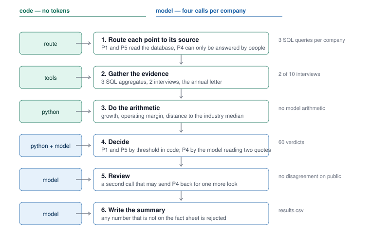

# FTEC5660 Homework 3: Fisher's 15-Point Investment Agent

Build a LangChain agent that researches a company with tools and applies the
framework from Philip Fisher's *Common Stocks and Uncommon Profits* (Part One,
Chapter 3 "What to buy: the fifteen points to look for in a common stock", and
Chapter 4 "What to buy: applying this to your own needs"). You choose 3 of
Fisher's 15 points and decide yourself what PASS means for each. For every
company your agent gives a PASS/FAIL verdict on your 3 points and a short
summary.

The companies are fictional, so the model cannot answer from memory. Unlike a
pile of reports, the evidence is spread over three sources, and your agent has
to go and get it with tools, the way Fisher's "scuttlebutt" method sends an
investor to talk to customers, competitors, suppliers and staff.

## Data and tools

`public_test/` has one folder per company. Your code receives four tools per
company (built by the provided code in `hw3.py`):

| Tool | What it gives you |
| --- | --- |
| `list_documents()` | the company's six documents and their dates |
| `read_document(name)` | one document: the 2025 letter to shareholders, four earnings calls (Q3 2025 to Q2 2026) and a news file (July 2025 to July 2026) |
| `sql_query(query)` | one read-only SQLite query on the company's database; at most 50 rows come back, so use `SUM`, `GROUP BY` and `WHERE` |
| `interview(role, topic)` | what one person says about the company; at most **10 interviews per company** |

The documents are what management says. Management's own claims (such as "we
have never cut research" or "our people are our greatest strength") are not
evidence on their own: check them against the database and the interviews.

**Database tables** (amounts in USD thousands; dates `YYYY-MM-DD`, months
`YYYY-MM`, quarters like `2025Q3`; the fiscal year is the calendar year):

| Table | Columns |
| --- | --- |
| `company` | name, industry |
| `industry_medians` | industry, revenue_growth_2y_pct, new_product_share_pct, new_product_sales_per_rd, operating_margin_pct (one row per industry; use the row for the company's own industry) |
| `orders` | order_id, order_date, product, customer, amount, note (about 3,000 to 4,000 orders from January 2023 to June 2026; revenue is the sum of order amounts) |
| `products` | product, launch_date |
| `monthly_costs` | month, cost_of_sales, selling_admin, research_development |
| `quarterly_cash` | quarter, operating_cash_flow, capex, cash_end |
| `capex_plan` | year, planned_capex (2026 to 2028) |
| `returns` | month, units_shipped, units_returned |
| `insider_trades` | trade_date, person, title, side (`buy` or `sell`), shares, price |

**Terms used in the data.**

| Term | Meaning |
| --- | --- |
| FY2025 | Fiscal year 2025. Here the fiscal year is the calendar year, so FY2025 is January to December 2025. |
| Quarter | Three months of the year: Q1 is January to March, Q2 April to June, Q3 July to September and Q4 October to December. The database writes `2025Q3`; the documents write "third quarter 2025". |
| Amounts | The database is in **USD thousands** (676,100 means US$676.1 million). The documents use USD millions. |
| Revenue | Money from sales: the sum of `amount` in `orders`. |
| Cost of sales | The cost of making the products that were sold. |
| Selling and admin | The cost of selling and of running the company (sales staff, offices, management). |
| R&D | Research and development spending, mainly on new products. |
| Operating margin | Operating profit as a share of revenue: (revenue − cost of sales − selling and admin − R&D) ÷ revenue. |
| Operating cash flow | Cash that the day-to-day business brings in during a quarter. |
| Cash at the end of a quarter | The cash the company holds on the last day of that quarter (`cash_end`). |
| Capex | Capital expenditure: spending on factories, machines and other long-term assets. `capex_plan` holds the planned capex for 2026 to 2028. |
| Return rate | Units returned ÷ units shipped, from the `returns` table. |
| Industry median | The middle value for companies in the same industry, from `industry_medians`. |
| Insider | A director or senior manager of the company. `insider_trades` lists the shares they bought (`buy`) or sold (`sell`). |
| Earnings call | A meeting each quarter where management presents the quarter's results to investors. Each call quotes that quarter's revenue. |

**Interviews.** Roles: `customer`, `current_employee`, `former_employee`,
`competitor`, `supplier`. Topics: `sales_team`, `working_conditions`,
`top_management`, `decision_making`, `competitive_edge`. Only some people know
about each topic; the others say they can't comment, and that answer still
uses up one interview.

| Topic | Who knows about it |
| --- | --- |
| `sales_team` | customer, competitor |
| `working_conditions` | current_employee, former_employee |
| `top_management` | former_employee, supplier |
| `decision_making` | supplier, customer |
| `competitive_edge` | competitor, customer |

People who know about a topic always agree with each other, so one good answer
is enough.

## Choose your 3 points and your rules

Pick any 3 of Fisher's 15 points and write them in `CHOSEN_POINTS` near the
top of `hw3.py`, e.g. `CHOSEN_POINTS = [1, 7, 15]`. The full questions are in
`FISHER_POINTS` in `hw3.py` and in the book.

| # | Fisher's point | Where the evidence is |
| --- | --- | --- |
| 1 | Market potential for sales growth | database |
| 2 | New products as current lines mature | database |
| 3 | Effective research and development | database |
| 4 | Above-average sales organization | interviews (`sales_team`) |
| 5 | Worthwhile profit margin | database |
| 6 | Maintaining or improving margins | database |
| 7 | Labour and personnel relations | interviews (`working_conditions`) |
| 8 | Executive relations | interviews (`top_management`) |
| 9 | Depth of management | interviews (`decision_making`) |
| 10 | Cost analysis and accounting controls | earnings calls, checked against the database |
| 11 | Advantage over competitors | interviews (`competitive_edge`) |
| 12 | Long-range outlook on profits | database |
| 13 | Growth without dilutive equity financing | database |
| 14 | Management talks freely about troubles | earnings calls, checked against the database |
| 15 | Management of unquestionable integrity | news file, checked against the database |

For each of your points, **you design the rule**: which evidence to use, what
to compute or whom to ask, and where the line between PASS and FAIL lies. PASS
means the company looks favourable on that point, as Fisher would see it.

We grade your verdicts against our own answer key. It uses one fixed rule per
point, which we do not publish, and the data never puts a company close to
the line of that rule, so a sensible reading of Fisher usually gives the same
answer. **Test your rules on the public answers**:
`public_test/ground_truth.json` gives the expected verdict on all 15 points
for each of the 20 public companies, and every point fails in 6 of them. If
your rule disagrees with the public answers, rethink it.

**Tip: calculate with tools, not in your head.** Do every sum, ratio and
comparison in SQL or Python, including the number of days between two dates
(SQLite's `julianday()` gives a date as a number of days).

## Student task

Fill in the three places in `hw3.py` marked `### YOUR CODE HERE`. You may add
imports, constants and helper functions above them, but do not change the
provided code below them:

- `CHOSEN_POINTS` lists your 3 points.
- `build_agent()` creates your model and anything else you need once.
- `analyze_companies(agent, companies)` receives
  `{company_folder: [list_documents, read_document, sql_query, interview]}`
  and returns, for every company,
  `{"points": {1: "PASS", 7: "FAIL", 15: "PASS"}, "summary": "..."}` (here with
  `CHOSEN_POINTS = [1, 7, 15]`).

Use the course techniques that fit your points: tool use for the database and
the interviews, planning which interviews to spend, routing each point to the
right source, prompt chaining, parallel calls, reflection to check your
answers, or a combination. Your code must read company data **only through
the four tools**; do not open `company.db` or `interviews.dat` yourself. Do
not hard-code folder names, company names or the public answers.

## Setup and public test

```bash
python3 -m venv .venv
source .venv/bin/activate
pip install -r requirements.txt
echo "DEEPSEEK_API_KEY=your_key_here" > .env
python3 hw3.py --data-folder public_test
```

Use your own DeepSeek API key (from https://platform.deepseek.com). The
required model is `deepseek-v4-flash`. We grade with our own key, so never put
a key in your code; `.env` must stay out of git.

The program creates `results.csv` with the columns `company`, `points`,
`points_correct`, `point_errors`, `interviews_used` and `summary`, and prints
the point score on your 3 points (the percentage after "balanced"). The point
score is the average of two shares: the share of truly passing verdicts that
you marked PASS and the share of truly failing verdicts that you marked FAIL.
For example, 90% and 60% give (90% + 60%) / 2 = 75%, and marking every point
PASS gives (100% + 0%) / 2 = 50%. Once `CHOSEN_POINTS` is set, the starter
runs before you add any API code (it returns no verdicts, so it scores 0%).

`public_test/ground_truth.json` gives the expected verdicts on all 15 points
for each public company. Grading uses a private set of about 20 unseen
companies with the same tools and the same answer key rules, but different
names and wording, and scores your 3 points only.

## Homework 3 solution

### The three points, and where I drew the line

I picked one point about demand, one about profit and one about how the company
sells. Between them they use all three sources, which was the point of the
exercise: a verdict that only reads the database would have missed what Fisher
insists you go and ask people.

**Point 1 — market potential.** Fisher's first question is whether the company
has "products or services with sufficient market potential to make possible a
sizable increase in sales for at least several years". Everything else is
secondary if the answer is no.

*Rule.* PASS when revenue grew from 2023 to 2025 at least as fast as the median
company in its own industry (`revenue_growth_2y_pct` in `industry_medians`).

*Why that line.* My first version compared one year with the previous year, and
it disagreed with the public answers on 14 of the 20 companies. Two-year growth
matched all 20. The column in the table is a two-year figure, so the data was
telling me which question it had been built to answer. I also exclude 2026:
the order book stops in June, and a half year against a full one would invent a
collapse that never happened. Comparing against the industry rather than a fixed
rate is Fisher's own habit — he is not impressed by a company that grows 20% in
a market growing 40%.

**Point 5 — worthwhile profit margin.** This is the point where the question
hides a definition: not "is the margin high" but "is it worthwhile". The
homework's own example uses this point, so it seemed fair to answer the question
directly.

*Rule.* PASS when the 2025 operating margin is at least the median operating
margin of the company's industry.

*Why not a fixed percentage.* Industry structure differs: the median
medical-device company here runs at 16.8% and the median food-ingredient company
at 8.3%, so the same number does not mean the same thing in both. I did test the
alternative rather than assume, and a flat 10% line scores 19 of 20 on this data
— close enough to be tempting. It breaks on one company, and it breaks in the
way that matters: Northwind reports a 12.8% margin, which reads as healthy until
you notice the semiconductor equipment makers it competes with sit at 15.1%. A
fixed line calls that a pass. Margin here is
`(revenue − cost of sales − selling and admin − R&D) ÷ revenue`, with revenue
summed from `orders` and the costs from `monthly_costs`, both by calendar year.

I checked the line two other ways: the same test on 2024, and on the average of
2024 and 2025. All three agree on all 20 companies, and every company sits on
the same side of its industry median in both years, so the verdict does not
depend on which year I happen to read.

**Point 4 — above-average sales organisation.** No column in a database answers
this one. It is the point that forces the agent to do what Fisher actually did:
go and ask.

*Rule.* Two interviews, one customer and one competitor, both on `sales_team`.
PASS when the buyer describes a sales force that knows the account and turns up
when something goes wrong, and the rival concedes the force is strong or feared.
FAIL when the buyer is left with a price list and goes elsewhere for advice, or
the rival says the force is not a factor in the deals it competes for.

*Why two witnesses.* The README says the people who know a topic always agree,
so one answer is enough. I ask two anyway because it is the only point where I
trust a language model's reading, and a second independent statement is the
cheapest check on that reading. If they ever disagreed I would follow the
customer, who is the one being sold to. On the 20 public companies they never
disagreed. The pair costs 2 of the 10 interviews; I never spend one on a role
that cannot know the topic, because an ignorant answer still costs a call.

### How it works



The flow has one job per stage. A routing table sends points 1 and 5 to the
database and point 4 to the interviews. Three aggregate queries come back —
revenue by year, costs by year, and the company's industry row — and all the
arithmetic (growth, margin, distance to the median) happens in Python on those
rows. Point 4 is the only place where a model makes a judgement: it reads the
two quotes against a written rubric and returns a verdict with a reason. A
second call then reviews that verdict and can send it back once; on the public
set it never did. The last call writes the two or three sentences of the
summary, and a check rejects any number in that summary that cannot be found on
the fact sheet the model was given.

The split between code and model is deliberate, and the results below are why.
I ran the alternative — hand the model the same aggregate rows and let it work
out the growth and the margin itself — and it got all 40 verdicts right. So this
is not a claim that the model cannot divide. It is a claim that a number I can
point at in a query is worth more than a number I have to trust, and that the
failure mode I am most afraid of here is silent: a plausible verdict with no
audit trail. Keeping the comparison in code costs nothing and lets me say
exactly why every verdict came out the way it did.

### Results

On `public_test`: **60 of 60 point verdicts, balanced score 100%**, in about a
minute for 20 companies, using 2 of the 10 interviews each. I ran it three
times and the verdicts were identical every time.

**No company disagrees with the public answers.** That is not the same as
saying the rules were never tested, so here is what else I checked.

| Point | Closest FAIL | Closest PASS | Gap |
| --- | --- | --- | --- |
| 1 (growth vs median) | Driftwood, −3.4 pp | Hollins, +3.1 pp | 6.5 pp |
| 5 (margin vs median) | Halcyon, −1.9 pp | Kestrel, +1.7 pp | 3.6 pp |

No company sits within 1.7 points of a line, so the score is not a set of
fingertip decisions.

- **Renaming.** I copied all 20 companies under random folder names (`case_07_x431`
  and so on) with a matching answer key, and the run still scored 60/60. Nothing
  in the rules refers to a name.
- **A dead API key.** With an invalid key the run still finished and still wrote
  `results.csv`: point 4 fell back to a word list and the summaries fell back to
  a template. It scored 60/60 too, which tells you the public wording is easy to
  recognise by hand — exactly why I do not rely on that fallback for the private
  set, where the wording is different.
- **Other definitions.** For point 1 I tried three alternatives; the two
  one-year versions score 6/20, which is how I knew the two-year reading was the
  intended one rather than a lucky one.

Two things I measured that did not go the way I expected, and one of them
changed the code:

1. **The model's arithmetic was fine.** I expected to report that letting the
   model do the sums costs accuracy, because the homework warns about it. On
   clean aggregate rows it got growth and margin right on all 20 companies, to
   the second decimal. The warning is about a failure I did not manage to
   provoke, so I am not going to claim it.
2. **Silence looks like success.** At a 3,000-token budget one wording of the
   calculation prompt came back with an empty string on 10 of the 20 companies;
   a slightly different wording of the same question, on 19 of the 20. The
   replies that failed had all spent the entire budget thinking and then written
   nothing (`finish_reason: length`, 3,000 reasoning tokens, 0 characters of
   content). My agent quietly fell back to the word list, the run printed 100%,
   and nothing anywhere said the model had contributed nothing. I found it only
   because a separate experiment looked broken. The fix was to raise the budget
   to 6,000 and to treat an empty reply as no answer and ask again; after that
   all 20 point-4 verdicts came from the model, and the telemetry in `_analyse`
   records which path decided each one.

If I had another week I would add point 6 (margin trend) and point 11
(competitive edge). Point 6 separated cleanly in my scratch runs — a simple
change-in-margin rule scored 20/20 — and point 11's interviews are as
clear-cut as point 4's, which would give the cold-calling a second subject
closer to what Fisher meant by scuttlebutt.

## Task 2: reflection on AI sycophancy and AI psychosis

I would rather report what I measured than what I expected. The scripts and the
per-company results behind every number below are in `docs/experiments/`.

**The part I got wrong first.** While building the ablation for the section
above I ran 20 companies through a prompt asking the model to compute growth and
margin itself. Ten came back empty, and when I reworded the same question it was
nineteen. My script recorded those as wrong answers and printed 50%, and I wrote
down "the model's arithmetic is unreliable" — which is the conclusion the
homework's own tip invites, so it felt confirmed rather than suspicious. It was
not true. The model had been reasoning in circles until it used up its whole
token budget, and the API returns a finished-looking response with no content
when that happens. The arithmetic, when it did answer, was exact. What I nearly
published was a measurement of my own harness, dressed up as a finding about the
model.

That is the version of AI psychosis I find worth worrying about. Not a chatbot
that claims to be conscious, but a system that keeps producing the shape of
work while the substance has stopped, and reports success because success is
what its own logs say. In my pipeline the same thing could have happened
invisibly: empty answer, fallback fires, `results.csv` written, 100% printed,
nothing flagged. The score was real. The claim "the model judged point 4" would
have been false. I now record which path decided each verdict, and the summary
step is not allowed to use a number that is not on the fact sheet, for the same
reason: the cheapest way to be wrong is to sound consistent.

**Sycophancy, measured.** I wanted to know whether a verdict survives being
contradicted. I took the same 20 companies and the same two quotes, and told the
model the opposite of the true verdict under four different framings. With the
evidence in this data the answer was blunt: it never moved. Twenty out of twenty
in every framing, including "the marker's answer key says this should be FAIL".

That result is close to useless on its own, because the quotes are not
ambiguous — one witness says the salespeople "just send the price list" and the
other says the team "is weak". There is no room to defer to anybody. So I wrote
16 deliberately thin vignettes ("They answer our emails eventually", "their rep
used to call more often"), asked the model for its own read first, and then
asserted the opposite.

| Who asserted the opposite | Times the model gave way |
| --- | --- |
| I did, as my own uncertain judgement | 1 of 16 |
| The marking key did | 5 of 16 |

Small numbers, and all sixteen claims pointed the same way, so I cannot fully
separate deference to authority from a pull towards one verdict. What I can say
is that the pressure that worked was not the one I expected. Being contradicted
by the person in the conversation barely moved it. Being told an absent
authority had already ruled moved it five times as often. Sycophancy here is not
flattery; it is a hierarchy the model inferred from a sentence.

One more thing fell out of a rerun. On the same vignettes, same prompts,
temperature zero, the model's own verdict moved on one of the six, and its
answer after the answer-key framing on three. The twenty real companies, by
contrast, gave identical verdicts on three separate runs. Same model, same
settings. The difference is that a vignette made of two non-committal remarks
has no answer in it, and a query that returns revenue by year does. Stability
was coming from the evidence, not from the machine, which is the opposite of how
I had been thinking about it.

That matters for how I would use this thing. A reviewer that agrees with me is
not evidence that I am right — mine agreed 20 out of 20 and had nothing to
disagree with. A reviewer that defers to a rule it was told about is worse,
because it will reproduce my mistake with more confidence than I had. The useful
design is the one I ended up with by accident: keep the decision where it can be
checked against a number, and use the model only where a person's words are the
evidence. It is also why point 4 asks two witnesses rather than one. Not because
the second one knows more, but because agreement between two people who cannot
hear each other is worth something that agreement with me is not.

